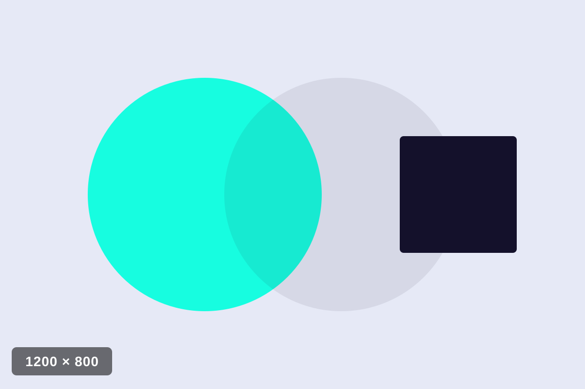

# Idiology — Design System Export

> Extracted verbatim from the built source (`assets/css/*.css`, `assets/js/**`, `index.html`).
> Nothing here is redesigned — every value is quoted from a real file. Where a value is
> declared once and reused everywhere, it is marked **[TOKEN]**. One-off hacks are flagged **[ONE-OFF]**.
>
> Stack: static HTML/CSS + vanilla ES-module JS. Dependencies loaded from CDN: **GSAP 3 + ScrollTrigger**, **Swiper 11**. No framework, no build step.

---

## 1. Color

The entire palette is declared once in `assets/css/tokens.css` as custom properties on `:root`. **[TOKEN]** — everything else references these; there are almost no raw hex values in the component CSS.

```css
:root {
  /* ---------- COLOR (electric blue/violet palette) ---------- */
  --c-bg-light:   #F3F4F9;   /* cool off-white */
  --c-bg-white:   #FFFFFF;
  --c-bg-grey:    #E9EBF4;
  --c-bg-dark:    #0B0721;   /* deep violet-navy (from #4300FF) */
  --c-text-dark:  #14112B;
  --c-text-light: #F3F4F9;
  --c-text-muted: #63667A;
  --c-text-muted-inv: #9FA3BC;
  --c-accent:     #00FFDE;   /* neon aqua — hover accents, loader */
  --c-accent-2:   #00CAFF;   /* cyan — secondary */
  --c-border-light: rgba(20,17,43,.14);
  --c-border-dark:  rgba(243,244,249,.16);
}
```

### By role

| Role | Token | Value | Used for |
|---|---|---|---|
| Background — light | `--c-bg-light` | `#F3F4F9` | body default, hero, mobile menu, `--curtain` on dark sections |
| Background — white | `--c-bg-white` | `#FFFFFF` | about, clients, blog, service cards, reader panel, dropdown |
| Background — grey | `--c-bg-grey` | `#E9EBF4` | services section |
| Background — dark | `--c-bg-dark` | `#0B0721` | projects, testimonials, footer, loader, page-transition |
| Text — dark | `--c-text-dark` | `#14112B` | primary body text on light |
| Text — light | `--c-text-light` | `#F3F4F9` | text on dark sections |
| Text — muted | `--c-text-muted` | `#63667A` | paragraphs/dates on light bg |
| Text — muted (inverse) | `--c-text-muted-inv` | `#9FA3BC` | paragraphs/links on dark bg |
| Accent | `--c-accent` | `#00FFDE` | all hover states, loader dot, focus fills, blockquote rule |
| Accent 2 | `--c-accent-2` | `#00CAFF` | secondary accent (declared; used mainly in the hero SVG + assets) |
| Border — light | `--c-border-light` | `rgba(20,17,43,.14)` | hairlines on light bg |
| Border — dark | `--c-border-dark` | `rgba(243,244,249,.16)` | hairlines on dark bg |

### Raw color values that appear OUTSIDE the token file (flag list)

These are the only places a literal color is hardcoded rather than tokenized:

- **Hero animated blob** (`index.html`, inline SVG `<stop>`): `#00CAFF` and `#4300FF`.
  `[ONE-OFF]` — SVG `<stop stop-color>` can't reliably read CSS vars, so hex is inlined. `#4300FF` (electric violet) exists **only** here and in the reduced-motion fallback + placeholder art; it is not a CSS token.
- **Reduced-motion hero fallback** (`animations.css`): `radial-gradient(... #00CAFF ...), radial-gradient(... #4300FF ...)` — mirrors the SVG blob as a static gradient.
- **Cursor** (`animations.css`): `background:#fff` / `border:1px solid #fff` on `.cursor-dot` / `.cursor-ring`. `[ONE-OFF]` — intentional pure white because it sits under `mix-blend-mode: difference`.
- **Sticky header bg** (`components.css`): `background: rgba(245,244,240,.92)`. `[ONE-OFF / STALE]` — this is a warm off-white left over from the original palette; it does **not** match the current cool `--c-bg-light` (#F3F4F9). Worth converting to `rgba(243,244,249,.92)`.
- **Link button underline** (`components.css`): `border-bottom: 1px solid rgba(23,23,23,.4)` and `.link-btn--light` uses `rgba(245,244,240,.4)`. `[ONE-OFF / STALE]` — also leftover warm-neutral rgba, not tokenized.
- **Shadows** use raw rgba (see Spacing/shadow notes): `rgba(0,0,0,.08)`, `rgba(20,17,43,.10)`, `rgba(0,0,0,.07)`, `rgba(0,0,0,.12)`.
- **Expand-band overlay** (`sections.css`): `linear-gradient(rgba(10,10,10,.45), rgba(10,10,10,.45))` — flat 45% black scrim for text contrast over the image.

---

## 2. Typography

### Fonts loaded

Three Google Fonts families, loaded async (print-swap trick) with a `<noscript>` fallback. From `index.html`:

```html
<link rel="preconnect" href="https://fonts.googleapis.com">
<link rel="preconnect" href="https://fonts.gstatic.com" crossorigin>
<link rel="preload" as="style" href="https://fonts.googleapis.com/css2?family=Instrument+Serif:ital@0;1&family=Inter:ital,opsz,wght@0,14..32,100..900;1,14..32,100..900&family=Unbounded:wght@200..900&display=swap">
<link href="https://fonts.googleapis.com/css2?family=Instrument+Serif:ital@0;1&family=Inter:ital,opsz,wght@0,14..32,100..900;1,14..32,100..900&family=Unbounded:wght@200..900&display=swap" rel="stylesheet" media="print" onload="this.media='all'">
<noscript>
  <link href="https://fonts.googleapis.com/css2?family=Instrument+Serif:ital@0;1&family=Inter:ital,opsz,wght@0,14..32,100..900;1,14..32,100..900&family=Unbounded:wght@200..900&display=swap" rel="stylesheet">
</noscript>
```

| Family | Var | Role | Axes / weights loaded |
|---|---|---|---|
| **Unbounded** | `--f-display` | headings, hero display, counters, card titles, testimonial author | variable weight **200–900** |
| **Inter** | `--f-body` | body, nav, UI, paragraphs, some card titles | variable, ital + opsz 14–32 + wght 100–900 |
| **Instrument Serif** | `--f-accent` | italic accent word inside headlines, blockquotes | roman + italic (`ital@0;1`) |

```css
--f-display: 'Unbounded', sans-serif;      /* [TOKEN] */
--f-body:    'Inter', sans-serif;          /* [TOKEN] */
--f-accent:  'Instrument Serif', serif;    /* [TOKEN] */
```

> Note: **Unbounded is used as a variable font** — the intro-demo work animated its `wght` axis live, and the type scale relies on real 200/400/600/700/800 weights. Keep the full 200–900 range when porting.

### Fluid type scale (all `clamp()`, tuned min @375px → max @1600px) **[TOKEN]**

```css
--fs-hero-xl:  clamp(3.4rem, 1.2rem + 9.5vw, 8.75rem);  /* hero display line */
--fs-hero:     clamp(1.6rem, 1rem + 2.6vw, 3.25rem);    /* hero intro, manifesto */
--fs-h2:       clamp(2.2rem, 1.2rem + 4.5vw, 5rem);     /* section headings (.h-display) */
--fs-h4:       clamp(1.15rem, 1rem + .8vw, 1.5rem);     /* card titles, sub-heads */
--fs-quote:    clamp(1.35rem, 1.05rem + 1.6vw, 2.1rem); /* testimonial quote */
--fs-counter:  clamp(3rem, 2rem + 4.5vw, 5.5rem);       /* stat counters */
--fs-body-lg:  1.25rem;   /* lead paragraphs (20px) */
--fs-body:     1.0625rem; /* body (17px) */
--fs-small:    .875rem;   /* 14px */
```

### Line-heights, tracking **[TOKEN]**

```css
--lh-tight: 1.08;   /* hero display lines */
--lh-head:  1.18;   /* headings */
--lh-body:  1.65;   /* body copy */
--ls-display: .015em;  /* display tracking */
```

### Complete role → spec table (as actually applied in CSS)

| Role | Font | Size | Weight | Line-height | Letter-spacing | Source |
|---|---|---|---|---|---|---|
| Hero display (`.hero__display`) | Unbounded | `--fs-hero-xl` | 800 | `--lh-tight` (1.08) | `.015em` | sections.css |
| Hero intro (`.hero__intro`) | Inter | `--fs-hero` | 600 | 1.18 | `.015em` | sections.css |
| Hero paragraph (`.hero__para`) | Inter | `--fs-body-lg` | 400 | 1.65 | — | sections.css |
| Section heading (`.h-display`) | Unbounded | `--fs-h2` | 700 | 1.18 | `.015em` | base.css |
| Accent word (`em.accent`) | Instrument Serif | `1.06em` | 400 *italic* | — | — | base.css |
| Manifesto (`.about__manifesto`) | Inter | `--fs-hero` | 600 | **1.35** `[ONE-OFF lh]` | — | sections.css |
| Counter value | Unbounded | `--fs-counter` | 600 | 1.1 | — | sections.css |
| Counter label | Unbounded | 15px | 400 | — | — | sections.css |
| Service card num | Unbounded | 14px | 400 | — | `.12em` | components.css |
| Service card title | Unbounded | `clamp(1.3rem, 1rem + 1.6vw, 2rem)` | 700 | 1.2 | — | components.css |
| Service card body | Inter | `--fs-body-lg` | 400 | 1.65 | — | components.css |
| Service deliverables li | Inter | 15px | 500 | — | — | components.css |
| Project card title (h4) | Inter | `--fs-h4` | 600 | — | — | components.css |
| Project card meta span | Inter | 14px | 400 | — | — | components.css |
| Blog card title | Inter | `--fs-h4` | 600 | — | — | components.css |
| Blog card date | Inter | 14px | 400 | — | — | components.css |
| Testimonial quote | Inter | `--fs-quote` | **450** `[ONE-OFF weight]` | 1.5 | — | sections.css |
| Testimonial author | Unbounded | 1.1rem | 700 | — | — | sections.css |
| Nav link | Inter | 15px | 500 | — | — | components.css |
| Dropdown link | Inter | 14px | 400 | — | — | components.css |
| Mobile menu link | Unbounded | `clamp(1.6rem, 8vw, 2.4rem)` | 700 | — | — | components.css |
| Link button (`.link-btn`) | Inter | 1rem | 600 | — | `.01em` | components.css |
| Footer col title | Unbounded | 1.05rem | 600 | — | — | components.css |
| Footer link | Inter | 15px | 400 | — | — | components.css |
| Reader title | Unbounded | `clamp(1.5rem, 1rem + 2.2vw, 2.4rem)` | 700 | 1.25 | — | components.css |
| Reader meta | Inter | 13px | 400 | — | `.1em` uppercase | components.css |
| Reader blockquote | Instrument Serif | 1.5rem *italic* | 400 | 1.45 | — | components.css |
| Clients heading | Inter | 1.5rem | 600 | — | — | sections.css |

Base element defaults (`base.css`): `h1,h2,h3,h4 { font-weight: 700; line-height: var(--lh-head); }`, body = Inter / `--fs-body` / `--lh-body` / `-webkit-font-smoothing: antialiased`.

---

## 3. Spacing & layout

### Spacing scale **[TOKEN]**

```css
--sp-section: clamp(72px, 6vw + 40px, 120px);  /* vertical rhythm between sections (padding-block) */
--sp-block:   60px;   /* heading→grid gap, section-head margin-bottom */
--sp-gap:     24px;   /* default grid gutter */
--sp-gap-lg:  40px;   /* (declared; larger gutter) */
```

Recurring raw spacing values not tokenized (common increments): `8, 10, 12, 14, 16, 20, 24, 28, 32, 40, 44, 48, 56, 64, 80, 96px`. `44px` recurs as the standard circular control size (avatars, arrows, plus, close, social).

### Container **[TOKEN]**

```css
--container-max: 1320px;
--container-pad: clamp(20px, 4vw, 48px);

.container {
  max-width: var(--container-max);
  margin-inline: auto;
  padding-inline: var(--container-pad);
}
```

### Grid systems

- **Global page grid**: 12-col — `grid-template-columns: repeat(12, 1fr); gap: var(--sp-gap)` (hero, about).
  - Hero: left `grid-column: 1 / 9`, right `10 / 13` (≥1400). At ≤1399 → `1/8` and `9/13`.
  - About body: `grid-column: 3 / 13` (pushed right).
- **Projects**: asymmetric two-column `grid-template-columns: 5fr 6fr; column-gap: clamp(24px, 6vw, 96px)`. Cards sized `--w66/--w83/--w75` with `margin-inline:auto` / `margin-left:auto` / `margin-right:auto` for the zig-zag.
- **Services stack**: single column flex; each card `grid-template-columns: minmax(0, 5fr) minmax(0, 7fr)` internally.
- **Blog**: `repeat(3, 1fr)` → 2 → 1.
- **Counters**: `repeat(4, 1fr)` → 2 → 1, with `border-left` dividers between cells.
- **Footer**: `grid-template-columns: 1.4fr 1fr 1fr .8fr` → 1fr.

### Vertical rhythm

Every content section uses `padding-block: var(--sp-section)` (72–120px fluid). Exceptions: clients uses a fixed `padding-block: 72px`; hero is `min-height: 100vh`; expand-band is `height: 115vh` (desktop) for scrub room.

### Breakpoints (max-width, all `.98` fractional to avoid overlap)

```
1399.98px   hero grid 8/4 → 7/5
991.98px    header shrink OFF (static); expand-band tween OFF (100% width);
            hero stacks; nav→burger; counters 4→2; blog 3→2
767.98px    projects → 1 col (button first); services card → 1 col; footer → 1 col
575.98px    counters → 1 col
768px       footer grid → 1fr (separate rule in components.css)
```

Utility: `[id] { scroll-margin-top: calc(var(--header-h-sticky) + 16px); }` keeps anchor targets clear of the fixed header.

---

## 4. Components

### 4.1 Header — fixed, sticky-shrink, transparent-over-hero

**Markup** (`index.html`):
```html
<header class="site-header is-transparent" data-header>
  <div class="container header__row">
    <a class="header__logo" href="/">
      
    </a>
    <nav class="header__nav" aria-label="Main">
      <ul class="header__menu">
        <li class="has-dropdown">
          <a href="#home">Home</a>
          <ul class="dropdown">
            <li><a href="#home">Digital Agency</a></li>
            <li><a href="#home">Creative Studio</a></li>
            <li><a href="#home">Portfolio Showcase</a></li>
          </ul>
        </li>
        <!-- …more li… -->
        <li><a href="#projects">Works</a></li>
      </ul>
    </nav>
    <div class="header__actions">
      <button class="header__search" aria-label="Search"><svg …></svg></button>
    </div>
    <button class="header__burger" data-burger aria-label="Menu" aria-expanded="false">
      <span></span><span></span><span></span>
    </button>
  </div>
</header>
```

**Key CSS** (`components.css`):
```css
.site-header {
  position: fixed; top: 0; inset-inline: 0; z-index: 100;
  height: var(--header-h);                 /* 96px [TOKEN] */
  border-bottom: 1px solid var(--c-border-light);
  background: transparent;
  transition: height .35s var(--ease-inout), background-color .35s var(--ease-inout);
}
.header__row { display: flex; align-items: center; gap: 32px; height: 100%; }
.header__menu { display: flex; gap: 36px; }
.header__menu > li > a {
  font-weight: 500; font-size: 15px; color: var(--c-text-dark);
  padding-block: 8px; position: relative;
}
/* nav underline: scaleX 0→1 from left on hover/focus */
.header__menu > li > a::after {
  content: ''; position: absolute; left: 0; right: 0; bottom: 2px;
  height: 1.5px; background: var(--c-text-dark);
  transform: scaleX(0); transform-origin: left center;
  transition: transform .3s var(--ease-inout);
}
.header__menu > li > a:hover::after,
.header__menu > li > a:focus-visible::after { transform: scaleX(1); }

/* Sticky shrink (JS toggles .is-sticky at scrollY > 30) */
.site-header.is-sticky {
  height: var(--header-h-sticky);          /* 70px [TOKEN] */
  background: rgba(245,244,240,.92);        /* [STALE — warm off-white] */
  backdrop-filter: blur(12px);
  -webkit-backdrop-filter: blur(12px);
}
.site-header.is-sticky .header__logo-img { transform: scale(.85); }

@media (max-width: 991.98px) {
  .header__nav, .header__actions { display: none; }
  .header__burger { display: flex; margin-left: auto; }
  .site-header.is-sticky { height: var(--header-h); }        /* no shrink on mobile */
  .site-header.is-sticky .header__logo-img { transform: none; }
}
```

**Dropdown** (hover/focus-within, 120ms delayed fade + 8px rise):
```css
.dropdown {
  position: absolute; top: 100%; left: -20px; min-width: 210px;
  background: var(--c-bg-white); border-radius: 8px;
  box-shadow: 0 20px 40px rgba(0,0,0,.08);
  padding: 12px 0; opacity: 0; visibility: hidden; transform: translateY(8px);
  transition: opacity .25s ease .12s, transform .25s ease .12s, visibility 0s linear .37s;
}
.has-dropdown:hover .dropdown, .has-dropdown:focus-within .dropdown {
  opacity: 1; visibility: visible; transform: translateY(0);
  transition: opacity .25s ease .12s, transform .25s ease .12s, visibility 0s linear .12s;
}
.dropdown a:hover { color: var(--c-text-muted); padding-left: 24px; }  /* slides right on hover */
```

**Burger → X** (3 spans, animate to cross):
```css
.header__burger.is-open span:nth-child(1) { transform: translateY(7px) rotate(45deg); }
.header__burger.is-open span:nth-child(2) { opacity: 0; }
.header__burger.is-open span:nth-child(3) { transform: translateY(-7px) rotate(-45deg); }
```

**Mobile overlay menu** — fullscreen, Unbounded links, staggered 40ms fade-up via `:nth-child` transition-delays:
```css
.mobile-menu { position: fixed; inset: 0; z-index: 200; background: var(--c-bg-light);
  display: grid; place-items: center; opacity: 0; visibility: hidden;
  transition: opacity .35s var(--ease-inout), visibility 0s linear .35s; }
.mobile-menu.is-open { opacity: 1; visibility: visible; transition: opacity .35s var(--ease-inout); }
.mobile-menu a {
  font-family: var(--f-display); font-weight: 700;
  font-size: clamp(1.6rem, 8vw, 2.4rem); color: var(--c-text-dark);
  opacity: 0; transform: translateY(24px); display: inline-block;
}
.mobile-menu.is-open a { opacity: 1; transform: none;
  transition: opacity .5s var(--ease-out-expo), transform .5s var(--ease-out-expo); }
.mobile-menu.is-open li:nth-child(1) a { transition-delay: .04s; }
/* …:nth-child(2) .08s … (6) .24s */
```

### 4.2 Link button — double-arrow swap (used ~10×)

**Markup**:
```html
<a class="link-btn" href="#">
  More About Us
  <span class="link-btn__arrows" aria-hidden="true">
    <svg class="arr arr--1" width="14" height="14" viewBox="0 0 16 16" fill="none" stroke="currentColor" stroke-width="1.5" stroke-linecap="round" stroke-linejoin="round"><path d="M2 8h11M9 3l5 5-5 5"/></svg>
    <svg class="arr arr--2" width="14" height="14" viewBox="0 0 16 16" fill="none" stroke="currentColor" stroke-width="1.5" stroke-linecap="round" stroke-linejoin="round"><path d="M2 8h11M9 3l5 5-5 5"/></svg>
  </span>
</a>
```

**CSS** — arrow 1 flies out right, arrow 2 flies in from left, inside a 1em overflow-hidden box:
```css
.link-btn {
  display: inline-flex; align-items: center; gap: 12px;
  font-family: var(--f-body); font-weight: 600; font-size: 1rem; letter-spacing: .01em;
  color: var(--c-text-dark);
  border-bottom: 1px solid rgba(23,23,23,.4);   /* [STALE rgba] */
  padding-bottom: 4px;
  transition: border-color var(--dur-fast) ease, color var(--dur-fast) ease;
}
.link-btn:hover { border-bottom-color: currentColor; }
.link-btn__arrows { position: relative; width: 1em; height: 1em; overflow: hidden; flex-shrink: 0; }
.link-btn__arrows .arr { position: absolute; inset: 0; margin: auto;
  transition: transform var(--dur-fast) var(--ease-out-expo); }
.link-btn__arrows .arr--1 { transform: translateX(0); }
.link-btn__arrows .arr--2 { transform: translateX(-150%); }
.link-btn:hover .arr--1 { transform: translateX(150%); }
.link-btn:hover .arr--2 { transform: translateX(0); }
/* dark-section variant: text goes light, hover → accent */
.link-btn--light { color: var(--c-text-light); border-bottom-color: rgba(245,244,240,.4); }
.link-btn--light:hover { color: var(--c-accent); border-bottom-color: currentColor; }
```

### 4.3 Project card — hover-zoom thumb

```html
<article class="proj-card" data-block-reveal="right">
  <a href="#">
    <div class="proj-card__thumb"></div>
    <div class="proj-card__meta"><h4>Kinetic Sandscapes</h4><span>2025 — Branding</span></div>
  </a>
</article>
```
```css
.proj-card__thumb { aspect-ratio: 4 / 3; overflow: hidden; border-radius: var(--radius-card); }
.proj-card__thumb img {
  width: 100%; height: 100%; object-fit: cover;
  transform: scale(1.02); transition: transform .9s var(--ease-out-expo);
}
.proj-card a:hover .proj-card__thumb img { transform: scale(1.09); }  /* slow zoom on hover */
.proj-card__meta h4 { font-family: var(--f-body); font-weight: 600; font-size: var(--fs-h4); color: var(--c-text-light); }
.proj-card__meta span { font-size: 14px; color: var(--c-text-muted-inv); }
```

### 4.4 Service card — scroll-stack panel (2-col: label + body)

```html
<article class="svc-card" style="--i:1">
  <div class="svc-card__side">
    <span class="svc-card__num">02</span>
    <div class="svc-card__icon"><svg width="24" height="24" …></svg></div>
    <h4><a href="#">Web Development</a></h4>
  </div>
  <div class="svc-card__body">
    <p>From stunning landing pages to dynamic web apps…</p>
    <ul class="svc-card__list">
      <li>Marketing sites &amp; landing pages</li>
      <li>Web applications</li>
      <li>CMS &amp; e-commerce</li>
      <li>Performance &amp; SEO foundations</li>
    </ul>
    <a class="link-btn" href="#">View Details <span class="link-btn__arrows">…</span></a>
  </div>
</article>
```
```css
.svc-card {
  background: var(--c-bg-white);
  border: 1px solid var(--c-border-light);
  border-radius: var(--radius-card);
  box-shadow: 0 16px 48px rgba(20,17,43,.10);
  padding: clamp(28px, 4vw, 56px);
  display: grid; grid-template-columns: minmax(0, 5fr) minmax(0, 7fr);
  gap: clamp(24px, 4vw, 64px);
  transform-origin: center top;              /* GSAP scales it from top when covered */
}
.svc-card__num { font-family: var(--f-display); font-weight: 400; font-size: 14px;
  letter-spacing: .12em; color: var(--c-text-muted); margin-bottom: 24px; }
.svc-card__icon {
  width: 64px; height: 64px; border: 1px solid var(--c-border-light); border-radius: 50%;
  display: grid; place-items: center; color: var(--c-text-dark); margin-bottom: 24px;
  transition: background-color .35s var(--ease-inout), border-color .35s var(--ease-inout);
}
.svc-card:hover .svc-card__icon { background: var(--c-accent); border-color: var(--c-accent); }  /* icon fills aqua */
.svc-card__list { display: grid; grid-template-columns: repeat(2, 1fr); gap: 0 32px; margin-bottom: 32px; }
.svc-card__list li { font-size: 15px; font-weight: 500; display: flex; align-items: center;
  padding-block: 12px; border-bottom: 1px solid var(--c-border-light); }
.svc-card__list li::before {   /* 6px square rotated 45° — the recurring list marker */
  content: ''; width: 6px; height: 6px; background: var(--c-text-dark);
  transform: rotate(45deg); margin-right: 12px; flex-shrink: 0;
}
@media (max-width: 767.98px) { .svc-card { grid-template-columns: 1fr; gap: 8px; } .svc-card__list { grid-template-columns: 1fr; } }
```
Stack positioning (`sections.css`):
```css
.services__stack .svc-card {
  position: sticky;
  top: calc(var(--header-h-sticky) + 24px + var(--i, 0) * 12px);  /* staggered sticky offset per card */
  margin-bottom: 48px;
}
```

### 4.5 Blog card + reader overlay

```html
<article class="blog-card" data-slug="transform-your-brand" data-block-reveal="left" data-reveal-delay=".12">
  <a href="#blog/transform-your-brand">
    <div class="blog-card__thumb"></div>
    <h4 class="blog-card__title"><span>Ready to transform your brand into something extraordinary</span></h4>
    <time class="blog-card__date" datetime="2026-06-18">June 18, 2026</time>
  </a>
</article>
```
```css
.blog-card__thumb { aspect-ratio: 3 / 2; overflow: hidden; border-radius: var(--radius-card); margin-bottom: 20px; }
.blog-card__thumb img { width:100%; height:100%; object-fit: cover; transform: scale(1.02); transition: transform .9s var(--ease-out-expo); }
.blog-card a:hover .blog-card__thumb img { transform: scale(1.09); }
.blog-card__title { font-family: var(--f-body); font-weight: 600; font-size: var(--fs-h4);
  display: -webkit-box; -webkit-line-clamp: 2; -webkit-box-orient: vertical; overflow: hidden; margin-bottom: 12px; }
/* underline draw-in via background-size (0%→100% of a 1.5px line) */
.blog-card__title span {
  background-image: linear-gradient(currentColor, currentColor);
  background-repeat: no-repeat; background-position: 0 100%; background-size: 0% 1.5px;
  transition: background-size .5s var(--ease-out-expo);
}
.blog-card a:hover .blog-card__title span { background-size: 100% 1.5px; }
```
Reader overlay (fullscreen, FLIP target — see Motion §5.7):
```css
.reader { position: fixed; inset: 0; z-index: 500; display: none; }
.reader.is-open { display: block; }
.reader__panel { position: absolute; inset: 0; background: var(--c-bg-white); opacity: 0; }
.reader__hero { height: min(52vh, 520px); overflow: hidden; }
.reader__close {
  position: absolute; top: 20px; right: 24px; z-index: 5; width: 44px; height: 44px; border-radius: 50%;
  border: 1px solid var(--c-border-light); background: rgba(255,255,255,.85); backdrop-filter: blur(8px);
  color: var(--c-text-dark); display: grid; place-items: center;
  transition: background-color .3s, border-color .3s, transform .3s;
}
.reader__close:hover { background: var(--c-accent); border-color: var(--c-accent); transform: rotate(90deg); }
.reader__close:focus-visible { outline: 2px solid var(--c-text-dark); outline-offset: 2px; }
.reader__body { max-width: 720px; margin-inline: auto; padding: 48px var(--container-pad) 96px; }
.reader__content blockquote { font-family: var(--f-accent); font-style: italic; font-size: 1.5rem;
  line-height: 1.45; border-left: 3px solid var(--c-accent); padding-left: 24px; margin: 1.8em 0; }
.reader__ghost { position: fixed; z-index: 600; object-fit: cover; border-radius: var(--radius-card);
  pointer-events: none; margin: 0; }   /* the flying FLIP clone */
```

### 4.6 Marquee (clients)

```html
<div class="marquee" data-marquee>
  <div class="marquee__track">
    <div class="marquee__set">
      
      <!-- …6 logos… JS clones the whole set once (aria-hidden) -->
    </div>
  </div>
</div>
```
```css
.marquee { overflow: hidden; margin-top: 32px; }
.marquee__track {
  display: flex; align-items: center; gap: 80px; width: max-content;
  animation: marquee 40s linear infinite;
}
.marquee__set { display: flex; align-items: center; gap: 80px; flex-shrink: 0; }
.marquee__set img { height: 32px; width: auto; filter: grayscale(1); opacity: .55;
  transition: filter .3s, opacity .3s; }
.marquee__set img:hover { filter: grayscale(0); opacity: 1; }
.marquee:hover .marquee__track { animation-play-state: paused; }   /* pause on hover */
@keyframes marquee { to { transform: translateX(-50%); } }         /* works because track = 2 identical sets */
```

### 4.7 Testimonial slider (Swiper 11)

```css
.testimonials .swiper { overflow: visible; padding-right: clamp(24px, 8vw, 120px); }  /* next-slide peek */
.testimonials .swiper-slide { opacity: .3; transition: opacity .5s ease; }
.testimonials .swiper-slide-active { opacity: 1; }
.testimonials__arrow {                       /* 44px circle, hover fills accent */
  width: 44px; height: 44px; border: 1px solid var(--c-border-dark); border-radius: 50%;
  display: grid; place-items: center; color: var(--c-text-light);
  transition: background-color .3s, color .3s, border-color .3s;
}
.testimonials__arrow:hover:not(:disabled) { background: var(--c-accent); border-color: var(--c-accent); color: var(--c-text-dark); }
.testimonials__arrow.is-disabled { opacity: .35; cursor: default; pointer-events: none; }
```
JS init:
```js
new Swiper(el, {
  slidesPerView: 1, spaceBetween: 100, loop: false, autoHeight: true,
  grabCursor: true, keyboard: { enabled: true },
  navigation: { prevEl: '[data-testi-prev]', nextEl: '[data-testi-next]', disabledClass: 'is-disabled' },
});
```

### 4.8 Counter (stat strip)

```html
<div class="counter">
  <div class="counter__value"><span data-counter data-to="12" data-append="+">0+</span></div>
  <div class="counter__label">Years of experience</div>
</div>
```
```css
.counters { display: grid; grid-template-columns: repeat(4, 1fr); margin-top: 56px; }
.counter { padding-inline: 32px; }
.counter:first-child { padding-left: 0; }
.counter + .counter { border-left: 1px solid var(--c-border-light); }
.counter__value { font-family: var(--f-display); font-weight: 600; font-size: var(--fs-counter);
  color: var(--c-text-dark); line-height: 1.1; }
.counter__label { font-family: var(--f-display); font-weight: 400; font-size: 15px; margin-top: 20px; }
```

### 4.9 Footer

```css
.footer { background: var(--c-bg-dark); color: var(--c-text-light); padding-block: var(--sp-section); }
.footer__grid { display: grid; grid-template-columns: 1.4fr 1fr 1fr .8fr; gap: 48px; }
.footer__links a { font-size: 15px; color: var(--c-text-muted-inv); display: inline-block;
  transition: color .25s, transform .25s; }
.footer__links a:hover { color: var(--c-text-light); transform: translateX(4px); }   /* nudge right */
.footer__social a {                          /* 40px circle, hover fills accent */
  width: 40px; height: 40px; border: 1px solid var(--c-border-dark); border-radius: 50%;
  display: grid; place-items: center; color: var(--c-text-light);
  transition: background-color .3s, color .3s, border-color .3s;
}
.footer__social a:hover { background: var(--c-accent); border-color: var(--c-accent); color: var(--c-text-dark); }
.footer__bottom { border-top: 1px solid var(--c-border-dark); padding-top: 32px; margin-top: 64px; }
@media (max-width: 768px) { .footer__grid { grid-template-columns: 1fr; } }
```

---

## 5. Motion

### 5.0 Shared tokens & global GSAP setup

**Easing / duration tokens** (`tokens.css`) — the whole system runs on these two curves:
```css
--ease-out-expo: cubic-bezier(0.16, 1, 0.3, 1);   /* [TOKEN] entrances, hover swaps */
--ease-inout:    cubic-bezier(0.65, 0, 0.35, 1);  /* [TOKEN] header, icon fills */
--dur-fast: .35s;   --dur-med: .7s;   --dur-slow: 1.1s;
```
GSAP equivalents used in JS: `ease: 'expo.out'` (entrances), `'power3.inOut'` (curtains), `'power2.out'` (counters), `'expo.inOut'` (FLIP), `'none'` (all scrubbed tweens).

**Global config** (`main.js`):
```js
gsap.registerPlugin(ScrollTrigger);
ScrollTrigger.defaults({ toggleActions: 'play none none none' }); // play once, never reverse
const REDUCE = window.matchMedia('(prefers-reduced-motion: reduce)').matches;
```
Boot order (`main.js` → `start()`): header, cursor, year, marquee, slider, page-transition, reader → **await `document.fonts.ready` (or 2s)** → textReveal, blockReveal, parallax, stack, counters, fadeUps → `ScrollTrigger.refresh()` → `initLoader().then(playHeroReveal)`.

> **Load gate**: text-splitting waits for fonts because line measurement depends on final metrics. **[system rule]**

### 5.1 Loader → hero handoff

`initLoader()` resolves only after the fade-out completes, so the hero reveal chains rather than overlaps.
```js
const minDelay = new Promise((r) => setTimeout(r, 400));
const loaded = document.readyState === 'complete' ? Promise.resolve()
  : new Promise((r) => window.addEventListener('load', r, { once: true }));
Promise.all([minDelay, loaded])
  .then(() => { el.classList.add('is-done'); return new Promise((r) => setTimeout(r, 600)); })
  .then(() => { el.classList.add('is-hidden'); });
```
CSS: overlay `z-index:9990`, `transition: opacity .6s var(--ease-inout)`. Dot pulse:
```css
.loader__dot { width:18px; height:18px; border-radius:50%; background: var(--c-accent); animation: pulse 1.2s infinite; }
@keyframes pulse { 0%{transform:scale(.6);opacity:.4} 50%{transform:scale(1);opacity:1} 100%{transform:scale(.6);opacity:.4} }
```

### 5.2 Text line reveal (`data-text-reveal`) — the signature effect

Custom line-splitter (no paid SplitText): wraps words in `.w`, groups by `offsetTop` into lines, wraps each line in `.line > .line-inner` (`.line { overflow:hidden }`). Lines slide up from behind the mask.
```js
gsap.from(lines, {
  yPercent: 110,
  duration: dur,               // data-duration attr; 1.0 hero intro/manifesto, 2.0 section headings/hero display
  ease: 'expo.out',
  stagger: 0.08,
  scrollTrigger: { trigger: el, start: 'top 85%' },   // scroll variant
});
```
- **Trigger**: `start: 'top 85%'` for scroll headings. Hero pair is chained after loader instead (intro delay 0, display delay 0.15, para fade delay 0.85).
- Element starts `visibility:hidden` in CSS; JS flips to visible after splitting (FOUC guard).
- Re-splits on resize (debounced 200ms, width-change only) then `ScrollTrigger.refresh()`.

### 5.3 Curtain / block reveal (`data-block-reveal="left|right"`)

A solid rectangle wipes across the card; content opacity flips to 1 mid-wipe.
```js
const dir = el.dataset.blockReveal === 'right' ? 'left' : 'right';  // origin side
const delay = el.dataset.revealDelay ? parseFloat(el.dataset.revealDelay)
                                     : parseInt(el.dataset.revealCol || 0, 10) * 0.08;
const tl = gsap.timeline({ delay, paused: true, scrollTrigger: { trigger: el, start: 'top 85%' } });
tl.fromTo(curtain, { scaleX: 0, transformOrigin: `${dir} center` },
                   { scaleX: 1, duration: 0.45, ease: 'power3.inOut' })
  .set(content, { opacity: 1 })
  .to(curtain, { scaleX: 0, transformOrigin: dir === 'left' ? 'right center' : 'left center',
                 duration: 0.45, ease: 'power3.inOut' });
```
Curtain element + color override:
```css
[data-block-reveal] .curtain { position:absolute; inset:0; z-index:2;
  background: var(--curtain, var(--c-bg-dark)); transform: scaleX(0); pointer-events:none; }
.projects [data-block-reveal] { --curtain: var(--c-bg-light); }   /* light curtain on dark bg */
```
- Projects wipe **right** (light curtain); blog wipes **left** with fixed `data-reveal-delay` .12/.24/.36 stagger.
- Total ≈0.9s per card.

### 5.4 Expand-band parallax scrub (desktop + motion-safe only)

Wrapped in `gsap.matchMedia('(min-width: 992px) and (prefers-reduced-motion: no-preference)')`:
```js
gsap.fromTo('[data-expand-target]', { width: '40vw' }, {
  width: '100vw', ease: 'none',
  scrollTrigger: { trigger: '[data-expand-band]', start: 'top 85%', end: 'top 15%', scrub: true },
});
gsap.fromTo('[data-parallax-bg]', { yPercent: -10 }, {
  yPercent: 10, ease: 'none',
  scrollTrigger: { trigger: '[data-expand-band]', start: 'top bottom', end: 'bottom top', scrub: true },
});
```
CSS gives scrub room: `.expand-band { height: 115vh }`, window `position: sticky; top: 11vh; width: 40vw; height: 78vh`. Below 992px the window is forced `width: 100% !important` and the tween never registers.

### 5.5 Services scroll-stack (depth on cover)

Layout is pure CSS `position: sticky`; GSAP only adds the depth cue. As the NEXT card slides over, the covered card scales to .95 and dims via **brightness (not opacity)** — a translucent card would ghost the one 12px beneath.
```js
gsap.fromTo(card, { scale: 1, filter: 'brightness(1)' }, {
  scale: 0.95, filter: 'brightness(0.82)', ease: 'none',
  scrollTrigger: {
    trigger: next, start: 'top bottom',
    end: () => 'top top+=' + (120 + i * 12),
    scrub: true, invalidateOnRefresh: true,
  },
});
```
> **Gotcha noted in source**: `fromTo` with explicit `filter:'brightness(1)'` start is required — GSAP parses an initial `filter:none` as `brightness(0)`. **[system rule]**

### 5.6 Counters — count-up

```js
const obj = { v: 0 };
gsap.to(obj, {
  v: to, duration: 2, ease: 'power2.out',
  scrollTrigger: { trigger: el, start: 'top 85%' },
  onUpdate: () => { el.textContent = Math.round(obj.v) + suffix; },
});
```
Data via attrs: `data-to="12" data-append="+"` → 12+, 225+, 42+, 98%.

### 5.7 Blog reader — FLIP expand (Codrops "expanding grid item")

Clicking a card flies a ghost clone of its thumb to the fullscreen hero position, then staggers content in. Deep-linked as `#blog/<slug>` with `history.pushState`; closes on ✕ / ESC / browser back; measures rects **after** scroll-lock so the scrollbar shift doesn't skew the FLIP. Open timeline:
```js
gsap.timeline({ onComplete: () => { ghost.remove(); animating = false; closeBtn.focus(); } })
  .to(panel, { opacity: 1, duration: 0.45, ease: 'power2.out' }, 0)
  .to(ghost, { top: to.top, left: to.left, width: to.width, height: to.height,
               borderRadius: 0, duration: 0.7, ease: 'expo.inOut' }, 0)
  .set(heroImg, { visibility: 'visible' })
  .to([metaEl, titleEl, contentEl], { opacity: 1, y: 0, duration: 0.6, ease: 'expo.out', stagger: 0.08 }, '-=0.05');
```
Close reverses the ghost back to the card rect (`ease:'expo.inOut'`, .6s) — but if the article was scrolled past the hero, it just fades (no cross-screen fly). Includes a minimal Tab focus-trap and returns focus to the card.

### 5.8 Custom cursor — dot + lerped ring

Dot follows pointer 1:1; ring lerps at 0.15 in a rAF loop; disabled on touch and reduced-motion.
```js
window.addEventListener('pointermove', (e) => { px=e.clientX; py=e.clientY; dot.style.transform=`translate(${px}px,${py}px)`; });
(function loop(){ rx += (px-rx)*0.15; ry += (py-ry)*0.15; ring.style.transform=`translate(${rx}px,${ry}px)`; requestAnimationFrame(loop); })();
// delegated hover on 'a, button, [data-cursor]' toggles .is-hover
```
```css
.cursor-dot, .cursor-ring { position:fixed; top:0; left:0; z-index:9999; pointer-events:none;
  border-radius:50%; mix-blend-mode: difference; }
.cursor-dot { width:8px; height:8px; background:#fff; margin:-4px 0 0 -4px; }
.cursor-ring { width:36px; height:36px; border:1px solid #fff; margin:-18px 0 0 -18px; transition:opacity .2s; }
.cursor-ring.is-hover { animation: cursorPulse .9s infinite; }
@keyframes cursorPulse { 0%{scale:1.6} 50%{scale:1.75} 100%{scale:1.6} }
@media (hover: none) { .cursor-dot, .cursor-ring { display:none; } }
```

### 5.9 Header sticky (JS)

Passive scroll listener with **4px hysteresis** (on at >30, off at <26) to avoid flicker:
```js
const onScroll = () => {
  const y = window.scrollY;
  if (!sticky && y > 30) { sticky = true; header.classList.add('is-sticky'); header.classList.remove('is-transparent'); }
  else if (sticky && y < 26) { sticky = false; header.classList.remove('is-sticky'); header.classList.add('is-transparent'); }
};
window.addEventListener('scroll', onScroll, { passive: true }); onScroll();
```

### 5.10 Fade-up entrance (`data-fade-up`)

```js
gsap.to(el, { opacity: 1, y: 0, duration: 0.7, ease: 'expo.out',
  delay: parseFloat(el.dataset.delay || 0),
  scrollTrigger: { trigger: el, start: 'top 85%' } });
```
Pre-state in CSS: `.js [data-fade-up] { opacity: 0; transform: translateY(24px); }`. Delays via `data-delay` (footer cols 0/.1/.2/.3; about para .85, button 1.05).

### 5.11 Marquee (JS half)

Only clones the authored logo set once so authors maintain one list; the CSS keyframes do the loop (§4.6):
```js
const clone = set.cloneNode(true); clone.setAttribute('aria-hidden', 'true'); track.append(clone);
```

### 5.12 Page transition (behind a flag)

`ENABLE_PAGE_TRANSITION = false` by default. When on: intercept same-origin non-hash clicks, fade `.page-transition` overlay in (`.35s`), then `location.href`. `[system: multi-page only]`

### ScrollTrigger config summary

| Effect | trigger | start | end | scrub | notes |
|---|---|---|---|---|---|
| text reveal | element | `top 85%` | — | no | play once |
| block reveal | element | `top 85%` | — | no | timeline, paused+delay |
| fade-up | element | `top 85%` | — | no | |
| counters | element | `top 85%` | — | no | |
| expand width | `[data-expand-band]` | `top 85%` | `top 15%` | **yes** | ≥992 + motion-safe |
| expand bg drift | `[data-expand-band]` | `top bottom` | `bottom top` | **yes** | |
| service stack depth | next card | `top bottom` | `top top+=(120+i*12)` | **yes** | `invalidateOnRefresh` |

Global default `toggleActions: 'play none none none'` — nothing re-triggers on scroll-up (except the scrubbed tweens, which are inherently reversible).

### Reduced-motion (system rule, enforced two ways)

Every JS module early-returns or `gsap.set`s the end-state when `REDUCE` is true. CSS backstop (`animations.css`):
```css
@media (prefers-reduced-motion: reduce) {
  .marquee__track { animation: none; }
  .expand-band__window { width: 100% !important; }
  .cursor-dot, .cursor-ring { display: none; }
  .loader { transition: none; }
  .hero__bg svg { display: none; }
  .hero__bg { background: radial-gradient(60% 60% at 30% 40%, #00CAFF 0%, transparent 70%),
                          radial-gradient(50% 50% at 75% 60%, #4300FF 0%, transparent 70%); }
  *, *::before, *::after { animation-duration: .01ms !important; animation-iteration-count: 1 !important; transition-duration: .01ms !important; }
}
```
And in `base.css`, the JS-gated pre-states are reset: `[data-text-reveal]{visibility:visible}`, `[data-block-reveal] > :not(.curtain){opacity:1}`, `[data-fade-up]{opacity:1;transform:none}`.

---

## 6. Assets

### Icons — inline SVG, 1.5px stroke, no icon font

All UI icons are hand-inlined `<svg>` with `stroke="currentColor" stroke-width="1.5"`, 24×24 or 16×16 viewBox. Small ones verbatim:

```html
<!-- Search (header) -->
<svg width="20" height="20" viewBox="0 0 24 24" fill="none" stroke="currentColor" stroke-width="1.5" stroke-linecap="round"><circle cx="11" cy="11" r="7"/><path d="M21 21l-4.35-4.35"/></svg>

<!-- Link-button arrow (repeated in every .link-btn) -->
<svg width="14" height="14" viewBox="0 0 16 16" fill="none" stroke="currentColor" stroke-width="1.5" stroke-linecap="round" stroke-linejoin="round"><path d="M2 8h11M9 3l5 5-5 5"/></svg>

<!-- Hero "plus" -->
<svg width="16" height="16" viewBox="0 0 16 16" stroke="currentColor" stroke-width="1.5" stroke-linecap="round"><path d="M8 2v12M2 8h12"/></svg>

<!-- Reader close -->
<svg width="16" height="16" viewBox="0 0 16 16" fill="none" stroke="currentColor" stroke-width="1.5" stroke-linecap="round"><path d="M2 2l12 12M14 2L2 14"/></svg>

<!-- Testimonial prev / next -->
<svg width="16" height="16" viewBox="0 0 16 16" fill="none" stroke="currentColor" stroke-width="1.5" stroke-linecap="round" stroke-linejoin="round"><path d="M14 8H3M7 3L2 8l5 5"/></svg>
<svg width="16" height="16" viewBox="0 0 16 16" fill="none" stroke="currentColor" stroke-width="1.5" stroke-linecap="round" stroke-linejoin="round"><path d="M2 8h11M9 3l5 5-5 5"/></svg>
```
Service icons: six 24×24 stroke glyphs (brush, half-circle, diamond, droplet, camera, overlapping-circles). Footer social: five 16×16 **filled** (`fill="currentColor"`) brand marks (Facebook, X, LinkedIn, Behance, Dribbble).

### Placeholder images (`assets/img/`) — all SVG

| Asset | Count | Size | Note |
|---|---|---|---|
| Project thumbs | 6 | 1200×900 | abstract blue/violet, aqua highlight |
| Blog thumbs | 3 | 1200×800 | |
| Avatars | 3 | 200×200 | |
| Client logos | 6 | ~180×40 | mono, `fill:#14112B` |
| Parallax bg | 1 | 2400×1600 | dark radial gradient, low-detail center |
| Logo | 2 | 150×50 | `logo-dark` (dark text) + `logo-light` (light text) |

> Every placeholder currently has a **dimension badge stamped into the SVG** (e.g. a `1200 × 900` pill) — decorative, remove when swapping in real art. All art recolored to the blue/violet palette (`#141040 #251E55 #372E6E` shadows, `#00FFDE #00CAFF #0065F8 #4300FF` highlights).

### Image treatments

- **Card thumbs**: `object-fit: cover`, `aspect-ratio: 4/3` (projects) or `3/2` (blog), `border-radius: var(--radius-card)` (4px), rest `scale(1.02)` → hover `scale(1.09)` over `.9s var(--ease-out-expo)`.
- **Client logos**: `filter: grayscale(1); opacity:.55` → hover full color.
- **Parallax bg**: `background: url(...) center/cover`, inset `-12% 0` for drift room, `::after` flat `rgba(10,10,10,.45)` scrim.
- **Reader hero**: `height: min(52vh, 520px)`, cover.
- Below-fold images: `loading="lazy" decoding="async"` + explicit `width`/`height` (CLS guard).

### Signature background effect — animated SVG blob (hero)

Pure inline SVG + SMIL, zero JS. Two `<rect>`s filled with drifting `<radialGradient>`s (`#00CAFF`, `#4300FF`), each with 3 independent `<animate>`/`<animateTransform>` loops on non-divisible durations (7/9/17/20/21/26/34s) so the pattern never visibly repeats. Wrapper: `.hero__bg { position:absolute; inset:0; z-index:0; filter: blur(28px); opacity:.55; }`. (Full markup in `index.html` lines 100–128.)

### Shadows / borders (recurring)

- **Hairline borders** everywhere: `1px solid var(--c-border-light|dark)` (rgba .14 / .16). No thick borders.
- Shadows (all raw rgba, not tokenized): dropdown `0 20px 40px rgba(0,0,0,.08)`; service card `0 16px 48px rgba(20,17,43,.10)`; hero client card `0 12px 32px rgba(0,0,0,.07)`; on-hover service `[from original spec, now replaced by the stack depth cue]`.
- `backdrop-filter: blur(12px)` sticky header, `blur(8px)` reader close.

---

## 7. What makes this theme look the way it does

Concrete, load-bearing choices — change any of these and it stops looking like Idiology:

1. **Oversized Unbounded display type** — hero line is `clamp(3.4rem, 1.2rem + 9.5vw, 8.75rem)` at weight **800**, line-height **1.08**. The whole identity leans on one heavy geometric display face pushed to ~140px.
2. **Serif italic accent word inside sans headlines** — exactly one word per heading wrapped in `<em class="accent">` → Instrument Serif italic at `1.06em`. This is the single "editorial" gesture against an otherwise geometric page.
3. **Alternating dark/light section rhythm** — `light → image → white → DARK(#0B0721) → grey → DARK → white → white → DARK`. Section backgrounds do the pacing; the deep violet-navy `#0B0721` is the anchor.
4. **One neon accent, used only for interaction** — `#00FFDE` aqua appears **only** on hover/focus/active states, the loader dot, and the blockquote rule. It is never body text. Every hover in the system resolves to this one color.
5. **Near-sharp corners** — `--radius-card: 4px` on everything (cards, thumbs). The only rounder radii are pills/circles (`50%` on the 40–44px controls) and two 8–12px one-offs (dropdown, hero client card). No soft `rounded-lg` anywhere.
6. **Hairline-only borders at ~14–16% opacity** — `rgba(20,17,43,.14)` / `rgba(243,244,249,.16)`. There is no heavy rule anywhere; separation is done with 1px lines and whitespace.
7. **Masked line-reveal as the house motion** — every heading slides up from behind an `overflow:hidden` mask with `yPercent:110 → 0`, `ease:'expo.out'`, `stagger:0.08`. The same masked-wipe grammar recurs as the card curtains and the loader/section handoffs, so the whole site feels like one motion vocabulary.
8. **Motion that means something, gated hard** — scrubbed effects (expand-band 40vw→100vw, service-card depth-on-cover) are tied to scroll position, and *every* effect has a `prefers-reduced-motion` off-switch in both JS and CSS. The custom difference-blend cursor + 40s logo marquee round out the "alive but controlled" feel.

---

### File map (for porting)

```
index.html                     markup + font/CDN loading + inline SVG blob + <template> article bodies
assets/css/tokens.css          [TOKEN] all custom properties (color, type, space, motion)
assets/css/base.css            reset, .container, .h-display, em.accent, JS-gated pre-states, reduced-motion resets
assets/css/components.css      header, link-btn, cards, reader, footer
assets/css/sections.css        per-section layout + all responsive breakpoints
assets/css/animations.css      loader, page-transition, cursor, curtain, marquee keyframes, reduced-motion
assets/js/main.js              GSAP setup, boot order, marquee/slider/fadeup/year/page-transition
assets/js/modules/
  textReveal.js  blockReveal.js  parallax.js  stack.js  counters.js
  header.js  cursor.js  loader.js  reader.js
```

CDN deps: GSAP 3 + ScrollTrigger + Swiper 11 (all `defer`, from jsdelivr). Fonts: Unbounded 200–900, Inter, Instrument Serif (Google Fonts, async print-swap).
```
```
